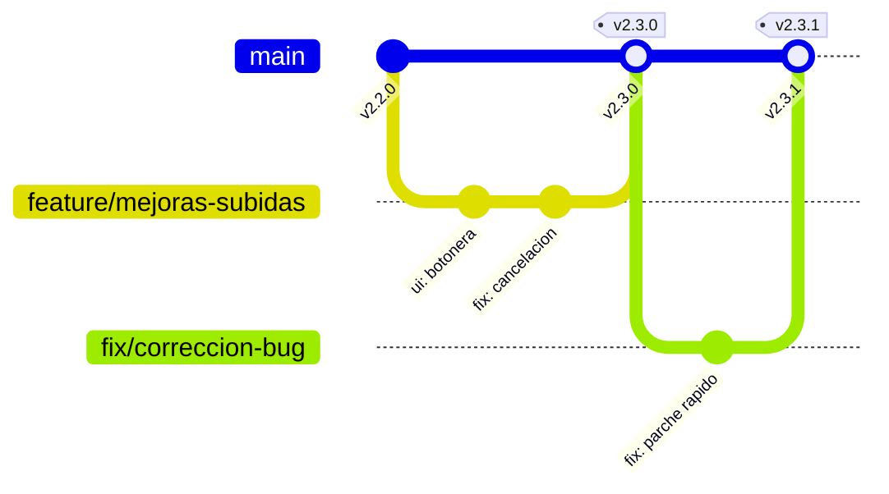

# 📘 Guía de Gestión con Git y GitHub para TeleVault

Esta guía documenta el flujo de trabajo estándar para desarrollar nuevas características, corregir errores, mantener un historial limpio y coordinar el trabajo con colaboradores sin comprometer la estabilidad del proyecto.

---

## 🧭 1. Filosofía de Ramas



* **`main` (Rama Principal / Producción):**
  * Es la rama que descargan y clonan los colaboradores.
  * **Regla de oro:** Siempre debe ser estable y funcionar al 100%. Nunca se debe programar directamente sobre `main` cuando se desarrollen cambios complejos o que puedan romper la aplicación.
* **Ramas temporales (`feature/...`, `fix/...`, `ui/...`):**
  * Ramas aisladas creadas para trabajar en una tarea concreta.
  * Una vez la tarea está probada y finalizada, se fusiona (*merge*) en `main` y la rama temporal se elimina.

---

## 🔄 2. Ciclo de Trabajo Diario (Paso a Paso)

### Paso 1: Asegurarse de tener la última versión de `main`
Antes de empezar cualquier desarrollo:
```bash
git checkout main
git pull origin main
```

### Paso 2: Crear una nueva rama de trabajo
Usa nombres descriptivos en minúsculas separados por guiones:
```bash
# Para una nueva funcionalidad:
git checkout -b feature/nombre-de-la-mejora

# Para corregir un error:
git checkout -b fix/nombre-del-fallo

# Para retoques estéticos o de diseño:
git checkout -b ui/retoque-modo-claro
```

### Paso 3: Realizar cambios y commits atómicos
Realiza commits frecuentes, pequeños y enfocados en una única responsabilidad.

```bash
# Ver qué archivos se han modificado:
git status

# Añadir archivos específicos al área de preparación (staging):
git add ruta/al/archivo.js ruta/al/estilo.css

# O añadir todos los cambios modificados:
git add .

# Crear el commit con un mensaje descriptivo:
git commit -m "feat: implementar selector nativo de carpetas"
```

### Paso 4: Probar la aplicación localmente
Verifica que la aplicación arranca y que la funcionalidad implementada trabaja como se espera sin generar errores de consola ni de backend:
```bash
python -m py_compile backend/main.py
node -c js/app.js
```

### Paso 5: Fusionar los cambios a `main`
Cuando todo esté listo y probado:
```bash
# 1. Cambiar a la rama principal:
git checkout main

# 2. Traer los cambios de la rama de trabajo:
git merge feature/nombre-de-la-mejora

# 3. Subir los cambios consolidados a GitHub:
git push origin main

# 4. Eliminar la rama local temporal (ya no hace falta):
git branch -d feature/nombre-de-la-mejora
```

---

## ✍️ 3. Convención de Mensajes de Commit (Conventional Commits)

Un historial claro permite identificar en segundos qué introdujo cada cambio. Usa siempre un prefijo descriptivo:

| Prefijo | Cuándo usarlo | Ejemplo |
| :--- | :--- | :--- |
| `feat:` | Nueva funcionalidad o botón | `feat: añadir boton limpiar finalizados y vaciar tabla` |
| `fix:` | Corrección de un fallo o error | `fix: cancelacion inmediata durante division binaria` |
| `ui:` | Ajustes de estilos, CSS, layout o temas | `ui: reordenar toolbar de subidas a la izquierda` |
| `docs:` | Modificaciones en documentación o guías | `docs: añadir seccion de grupos con temas en guia de uso` |
| `refactor:` | Limpieza o reestructuración de código sin alterar su función | `refactor: modularizar funciones de red en telegram.js` |
| `perf:` | Mejoras de rendimiento o velocidad | `perf: lectura en bloques de 16 MiB para streaming binario` |
| `chore:` | Tareas de mantenimiento o configuración (ej: `.gitignore`) | `chore: ignorar logs y carpetas temporales` |

---

## 🏷️ 4. Versionado y Creación de Releases en GitHub

Para que los colaboradores sepan qué versión exacta están probando y puedan descargarla fácilmente:

### Paso 1: Crear y subir una etiqueta (Git Tag)
Sigue el formato SemVer (`vMAYOR.MENOR.PARCHE`):
* **MAYOR**: Grandes rediseños estructurales (ej: `v3.0.0`).
* **MENOR**: Nuevas funcionalidades compatibles hacia atrás (ej: `v2.3.0`).
* **PARCHE**: Correcciones rápidas de bugs (ej: `v2.3.1`).

```bash
# Crear la etiqueta anotada:
git tag -a v2.3.0 -m "Release v2.3.0: Nuevos controles de tabla y cancelacion inmediata"

# Subir la etiqueta al repositorio remoto en GitHub:
git push origin v2.3.0
```

### Paso 2: Crear la Release en GitHub
1. Abre tu repositorio en GitHub: `https://github.com/DavidEsquinasSanchez/UploadVideoTelegram`.
2. En la barra lateral derecha, haz clic en **Releases** ➔ **Draft a new release**.
3. Selecciona la etiqueta creada (`v2.3.0`).
4. En el título de la release escribe: `TeleVault v2.3.0`.
5. En la descripción incluye una lista breve de cambios:
   ```markdown
   ### 🚀 Novedades y Mejoras
   - Reorganización de botones de subida a la izquierda.
   - Nuevos botones «Limpiar Finalizados OK» y «Vaciar Tabla».
   - Cancelación inmediata en tiempo real durante la preparación y subida de archivos.
   - Eliminación de iconos redundantes de papelera en cabeceras de tabla.
   ```
6. Pulsa **Publish release**. GitHub empaquetará automáticamente un archivo `.zip` con el código limpio listo para que tus colaboradores lo descarguen con un clic.

---

## 🤝 5. Gestión y Colaboración con Terceros

### Gestión de Incidencias con GitHub Issues
1. Pide a tus colaboradores que registren sugerencias, preguntas o errores mediante **GitHub Issues** (*Pestaña "Issues" ➔ "New Issue"*).
2. Puedes asignarles etiquetas de color (`bug`, `enhancement`, `question`).
3. Cuando hagas un commit que resuelva una issue específica, añade `closes #número` en el mensaje:
   ```bash
   git commit -m "fix: resolver cuelgue al cancelar subida (closes #4)"
   ```
   *Al subir a `main`, GitHub cerrará la issue automáticamente y la vinculará al commit.*

### Protección de la rama `main`
Para evitar subidas accidentales directas si más personas obtienen permisos de escritura en el futuro:
1. En GitHub, ve a **Settings** ➔ **Branches**.
2. Haz clic en **Add branch protection rule**.
3. En *Branch name pattern* escribe `main`.
4. Marca la opción:
   * `Require a pull request before merging` (exige que cualquier colaborador abra un Pull Request para que tú lo revises y apruebes antes de que se fusione con `main`).

---

## 🧰 6. Chuleta Rápida de Comandos Útiles

| Necesidad | Comando |
| :--- | :--- |
| Ver estado actual de archivos modificados | `git status` |
| Ver diferencias concretas de código línea por línea | `git diff` |
| Ver historial de commits compacto y gráfico | `git log --oneline --graph --decorate -n 10` |
| Deshacer cambios no guardados en un archivo concreto | `git restore ruta/al/archivo` |
| Guardar cambios a medias temporalmente para cambiar de rama | `git stash` |
| Recuperar los cambios guardados con stash | `git stash pop` |
| Ver todas las ramas locales y remotas | `git branch -a` |
| Deshacer el último commit local manteniendo los archivos editados | `git reset --soft HEAD~1` |

---

> [!TIP]
> **Seguridad ante todo:** Antes de cada `git commit`, revisa siempre con `git status` que no se esté añadiendo ningún archivo sensible (`.env`, archivos `.session` de Telegram o claves personales). El archivo `.gitignore` ya está configurado para protegerte, pero siempre es una buena práctica verificarlo.
